# Informe Etapa 6: stack de monitoreo con Docker Compose

Infraestructura de Redes II · Etapa 6 · cierre

## Introducción

En este informe redesplegué el stack de monitoreo de la Etapa 6 en Killercoda y expliqué su `docker-compose.yml`. El stack tiene cinco servicios que corren en una red común:

| Servicio | Para qué sirve |
| --- | --- |
| `mysql` | Base de datos de la app |
| `dbexporter` | Traduce el estado de MySQL a métricas que Prometheus entiende |
| `cadvisor` | Expone métricas de los contenedores Docker (CPU, memoria, red) |
| `prometheus` | Recolecta las métricas (hace *scrape* cada pocos segundos) |
| `grafana` | Visualiza las métricas en dashboards |

Además, la app Flask de la práctica corre fuera de Compose, en el host, y expone sus métricas en `/metrics`.

La diferencia entre **métrica** y **log**: una métrica es un número que cambia en el tiempo (sirve para ver tendencias y picos), mientras que un log es un evento puntual con todo su detalle.

El setup se ejecutó con `bash /root/setup.sh`, que levanta todo el entorno:

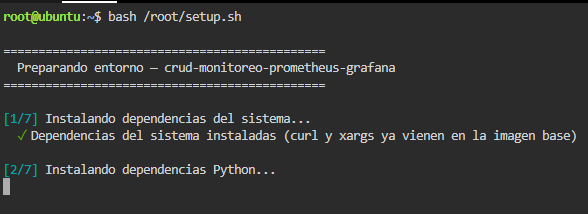
*Ejecución del script de preparación del entorno.*

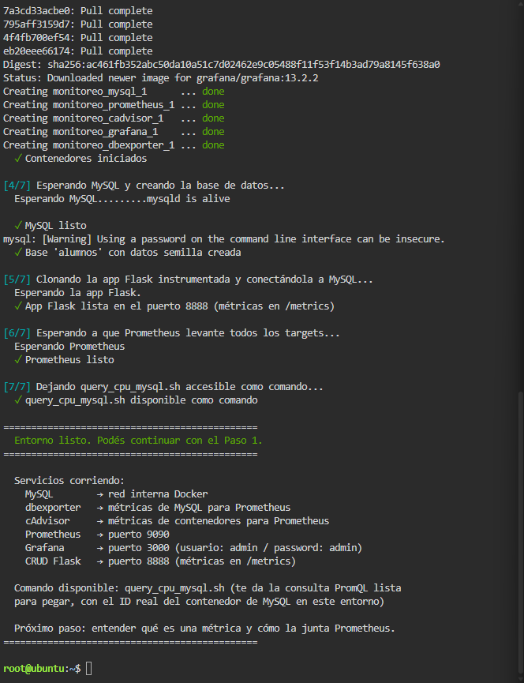
*Resumen final con los servicios levantados.*

El script genera los archivos en `/root/monitoreo/`. Con `docker-compose ps` se ven los cinco contenedores en estado Up:

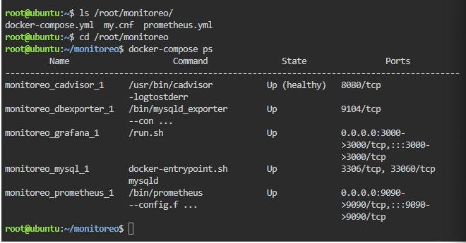
*Archivos generados por el setup y los cinco contenedores en ejecución.*

El archivo completo es el siguiente:

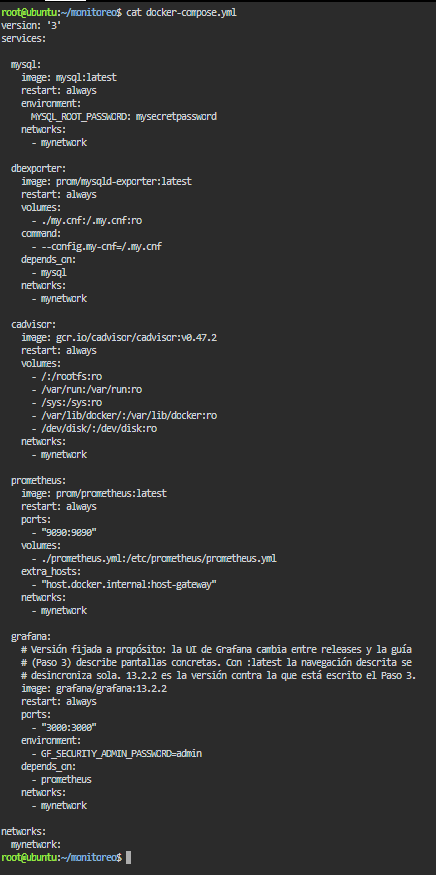
*Contenido del `docker-compose.yml` del stack.*

---

## Parte 1: Persistencia de datos (`mysql` y `dbexporter`)

```yaml
mysql:
  image: mysql:latest
  restart: always
  environment:
    MYSQL_ROOT_PASSWORD: mysecretpassword
  networks:
    - mynetwork

dbexporter:
  image: prom/mysqld-exporter:latest
  restart: always
  volumes:
    - ./my.cnf:/.my.cnf:ro
  command:
    - --config.my-cnf=/.my.cnf
  depends_on:
    - mysql
  networks:
    - mynetwork
```

**Qué hace cada servicio.** `mysql` es la base de datos de la app. `dbexporter` (`mysqld-exporter`) se conecta a MySQL y publica su estado como métricas por HTTP, para que Prometheus pueda leerlo.

**Por qué la contraseña va por variable de entorno.** La imagen oficial de MySQL lee `MYSQL_ROOT_PASSWORD` al arrancar por primera vez para crear el usuario `root`. En este archivo está escrita en texto plano, lo cual sirve para una práctica pero deja la contraseña a la vista en Git. En un entorno real se usaría un archivo `.env` que no se sube al repositorio, o `secrets:`.

**Para qué se monta `my.cnf` de solo lectura.** `./my.cnf:/.my.cnf:ro` copia al contenedor el archivo de configuración con los datos de conexión a MySQL. El sufijo `:ro` (*read only*) hace que el contenedor pueda leerlo pero no modificarlo, que es lo que necesita el exporter. Con `command` se le indica con `--config.my-cnf` dónde está ese archivo.

El `my.cnf` real tiene los datos de conexión del exporter: usuario `root`, la contraseña, `host=mysql` (el nombre del servicio, que se resuelve por la red) y el puerto `3306`. Eso muestra que la contraseña también está escrita en texto plano en este archivo.

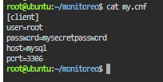
*Contenido de `my.cnf`: conexión del exporter a MySQL por nombre de servicio.*

**La relación de dependencia.** `depends_on: - mysql` hace que el contenedor de `mysql` arranque antes que `dbexporter`. Solo garantiza el orden de arranque: no espera a que MySQL esté listo para aceptar conexiones. Por eso `dbexporter` tiene `restart: always`, para que se vuelva a levantar si arrancó demasiado pronto.

**Sintaxis YAML que aparece:**
- `environment` está escrito como **mapa** (`CLAVE: valor`).
- `volumes`, `command`, `depends_on` y `networks` son **listas** (cada elemento empieza con `-`).
- `image` y `restart` son **escalares** (texto).

**Una observación:** `mysql` no tiene `volumes:`, así que sus datos viven dentro del contenedor. Si se hace `docker-compose down` y se vuelve a levantar, se pierden.

**Evidencia.** La consulta `mysql_global_status_threads_connected` en Prometheus devuelve las conexiones activas, y viene del `dbexporter` (`instance="dbexporter:9104"`):

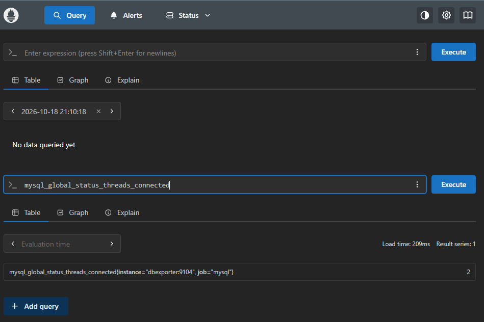
*Conexiones activas en MySQL (2), consultadas a través del `dbexporter`.*

**En la práctica:** `docker-compose ps` mostró `mysql` y `dbexporter` en estado Up, y la consulta `mysql_global_status_threads_connected` devolvió 2 conexiones activas.

## Parte 2: Recolección de métricas (`cadvisor` y `prometheus`)

```yaml
cadvisor:
  image: gcr.io/cadvisor/cadvisor:v0.47.2
  restart: always
  volumes:
    - /:/rootfs:ro
    - /var/run:/var/run:ro
    - /sys:/sys:ro
    - /var/lib/docker/:/var/lib/docker:ro
    - /dev/disk/:/dev/disk:ro
  networks:
    - mynetwork

prometheus:
  image: prom/prometheus:latest
  restart: always
  ports:
    - "9090:9090"
  volumes:
    - ./prometheus.yml:/etc/prometheus/prometheus.yml
  extra_hosts:
    - "host.docker.internal:host-gateway"
  networks:
    - mynetwork

**En la práctica:** Prometheus tenía los cuatro targets en UP. La CPU del contenedor de MySQL tuvo un pico de unos 0,12 al arrancar y después se estabilizó cerca de 0,006.

**Qué hace cada servicio.** `cadvisor` mide el uso de recursos de todos los contenedores del host y los expone como métricas. `prometheus` va a buscar esas métricas (y las de MySQL y la app) a intervalos regulares, según lo que dice `prometheus.yml`.

**Por qué `cadvisor` monta rutas del host en solo lectura.** Para medir los contenedores necesita mirar el sistema de archivos del host (`/`, `/sys`, `/var/lib/docker`, `/var/run`, `/dev/disk`). Con `:ro` puede leer esa información pero no puede modificar nada del host, lo que lo hace más seguro.

**Qué puerto se publica y por qué.** Solo `prometheus` publica un puerto: `"9090:9090"` (puerto del host : puerto del contenedor), porque nosotros entramos a su interfaz desde el navegador. `cadvisor` no publica ninguno: Prometheus llega a `cadvisor:8080` por la red interna, y desde afuera no se puede entrar. Es una regla de seguridad: se publica solo lo que un humano necesita ver.

**Qué resuelve `extra_hosts` con `host.docker.internal`.** La app Flask corre en el host, fuera de Compose. `"host.docker.internal:host-gateway"` agrega una línea al `/etc/hosts` del contenedor de Prometheus, donde `host-gateway` es la IP del host. Así Prometheus puede scrapear `host.docker.internal:8888/metrics`.

**Sintaxis YAML que aparece:** listas de volúmenes con el formato `ruta_host:ruta_contenedor:ro`, y los puertos y `extra_hosts` entre comillas, porque YAML puede interpretar `22:22` como un número en base 60 si no las llevan.

El archivo `prometheus.yml` define un `scrape_interval` global de 5 segundos y cuatro jobs: `prometheus` (`localhost:9090`), `cadvisor` (`cadvisor:8080`), `mysql` (`dbexporter:9104`) y `crud-app` (`host.docker.internal:8888`). Los tres primeros se resuelven por nombre dentro de la red, y el último gracias a `extra_hosts`.

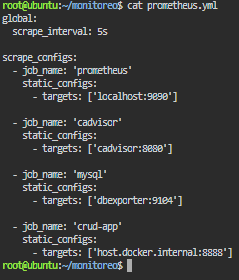
*Configuración de scraping de Prometheus: intervalo de 5 segundos y cuatro jobs.*

**Evidencia.** La app expone sus métricas en `/metrics`, que es lo que lee Prometheus:

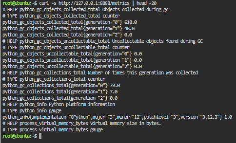
*Métricas de la app Flask expuestas en `/metrics`.*

Prometheus tiene cuatro targets, todos en UP:

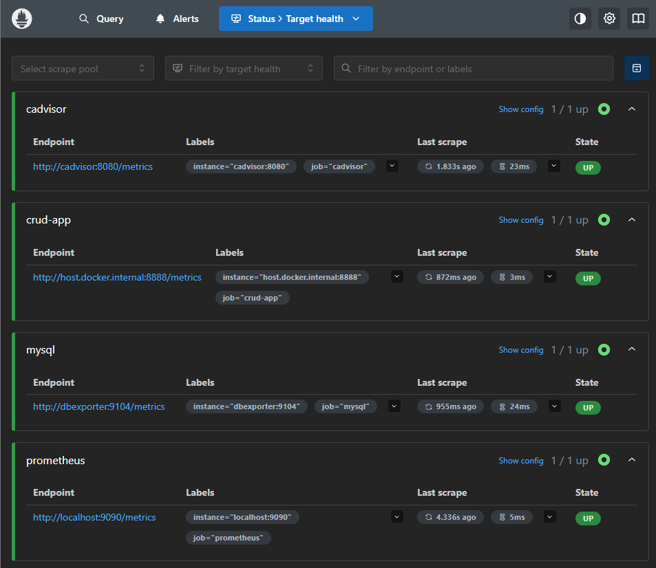
*Los cuatro targets de Prometheus funcionando.*

La consulta `up` devuelve 1 por cada target que responde:

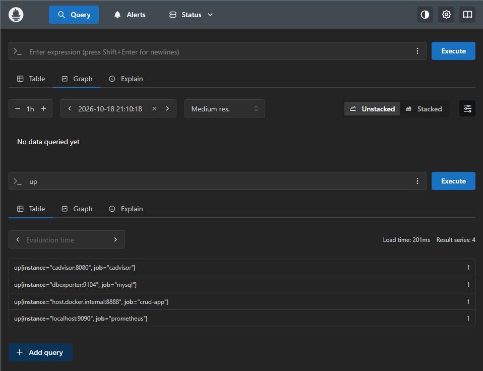
*Consulta `up`: estado de salud de los targets.*

El script `query_cpu_mysql.sh` imprime la consulta con el ID del contenedor de MySQL, porque cAdvisor identifica los contenedores por el ID de su cgroup y no por el nombre:

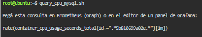
*Consulta generada con el ID real del contenedor de MySQL.*

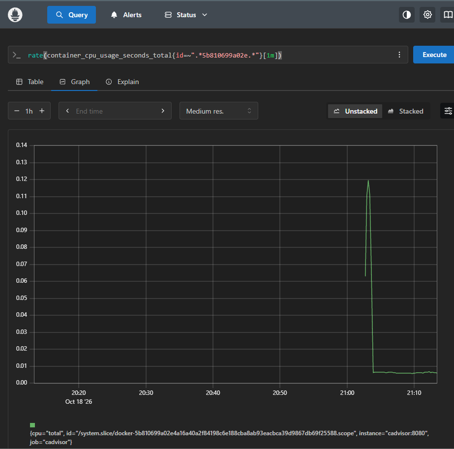
*Uso de CPU del contenedor de MySQL, medido por cAdvisor.*

---

## Parte 3: Visualización y topología (`grafana` y la red `mynetwork`)

```yaml
grafana:
  image: grafana/grafana:13.2.2
  restart: always
  ports:
    - "3000:3000"
  environment:
    - GF_SECURITY_ADMIN_PASSWORD=admin
  depends_on:
    - prometheus
  networks:
    - mynetwork

networks:
  mynetwork:
```

**Qué hace `grafana`.** No recolecta nada por sí mismo: se conecta a Prometheus como fuente de datos y arma paneles y dashboards con las métricas que ya tiene guardadas. Publica el puerto `3000` para entrar desde el navegador.

**Por qué Grafana depende de Prometheus.** `depends_on: - prometheus` hace que `prometheus` arranque antes, ya que Grafana necesita a Prometheus como fuente de datos. Igual que antes, esto solo garantiza el orden de arranque y no que Prometheus ya esté listo.

**Cómo la red común permite resolver por nombre.** Los cinco servicios están en `mynetwork`. Docker les da un DNS interno en el que el nombre del servicio es su nombre de host, sin usar ninguna IP. Por eso en Grafana el data source apunta a `http://prometheus:9090`, y Prometheus consulta a `dbexporter:9104` y `cadvisor:8080`.

**Sintaxis YAML que aparece:** `environment` está escrito acá como **lista** (`- VARIABLE=valor`), a diferencia de `mysql`, donde era un mapa. Las dos formas son válidas y hacen lo mismo. Además, `networks:` aparece a nivel raíz para declarar la red, y dentro de cada servicio para unirlo a ella.

**Evidencia.** El data source de Prometheus con la URL por nombre de servicio:

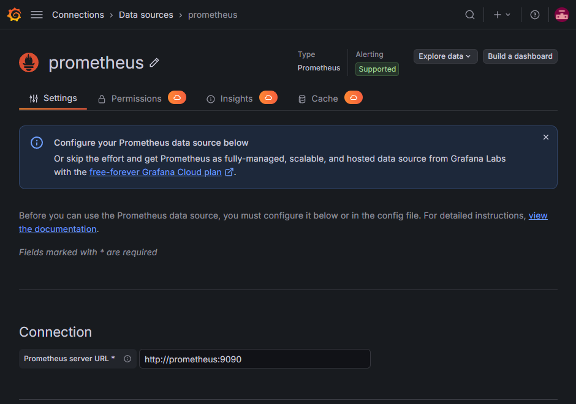
*Data source de Prometheus apuntando al servicio por nombre.*

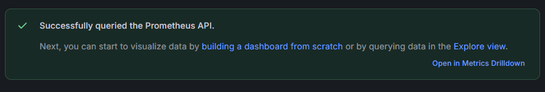
*Prueba de conexión exitosa entre Grafana y Prometheus.*

Con `docker network ls` se ve la red del stack, `monitoreo_mynetwork`: Compose le antepone el nombre del proyecto (la carpeta `monitoreo`) al nombre `mynetwork` declarado en el archivo.

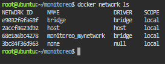
*Red `monitoreo_mynetwork` creada por Compose para el stack.*

Primer panel, con la consulta de peticiones por segundo de la app:

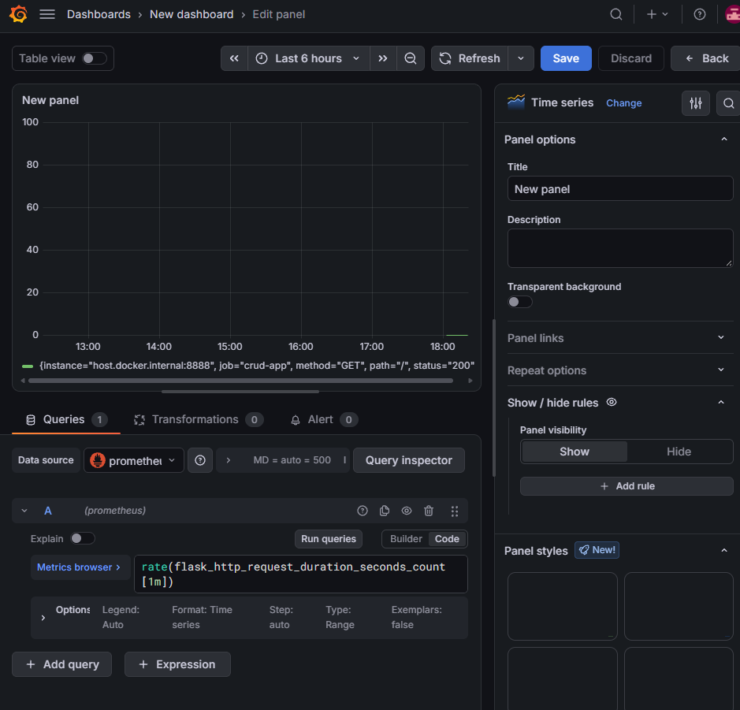
*Panel de peticiones por segundo de la app Flask.*

Dashboard con los tres paneles (conexiones a MySQL, requests por segundo y CPU de MySQL) antes de generar carga:

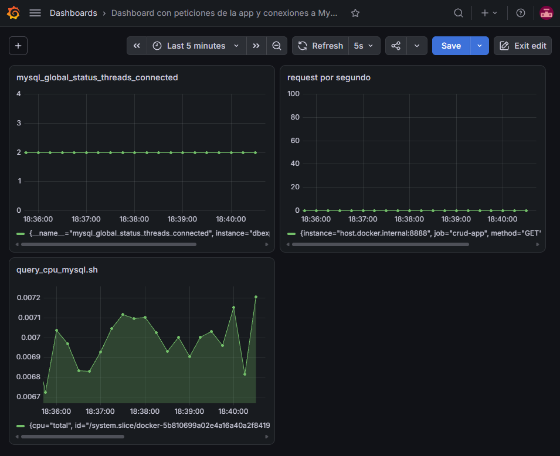
*Dashboard antes del stress test.*

Prueba de carga, 2000 peticiones con 50 en simultáneo:

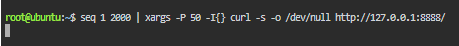
*Comando del stress test.*

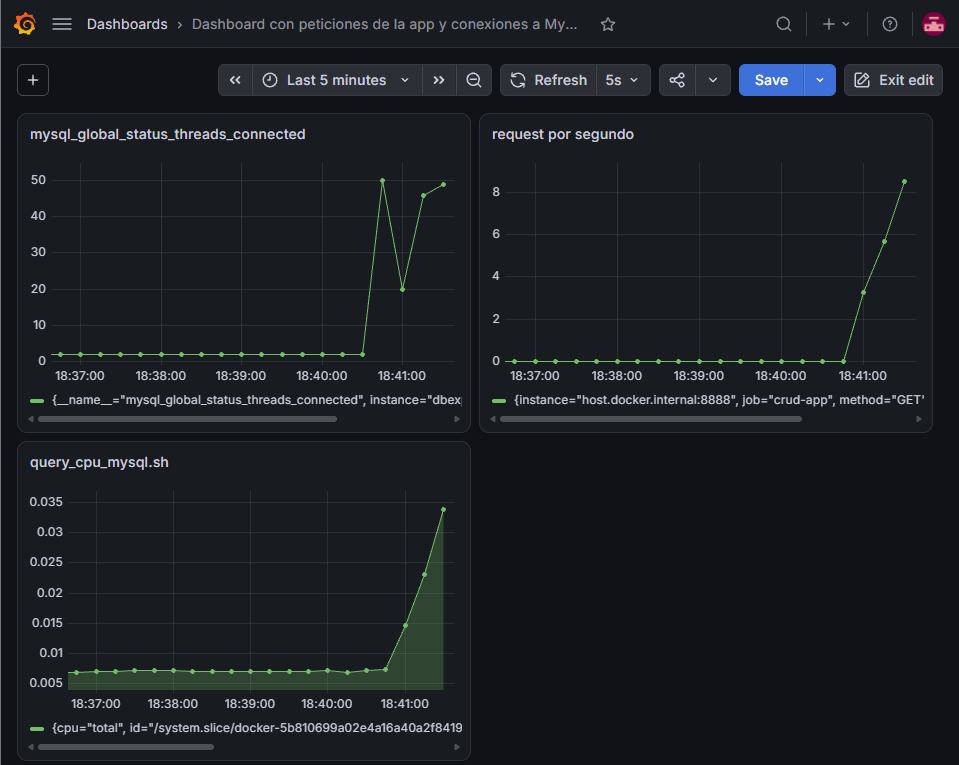
*Los tres paneles subiendo durante la carga.*

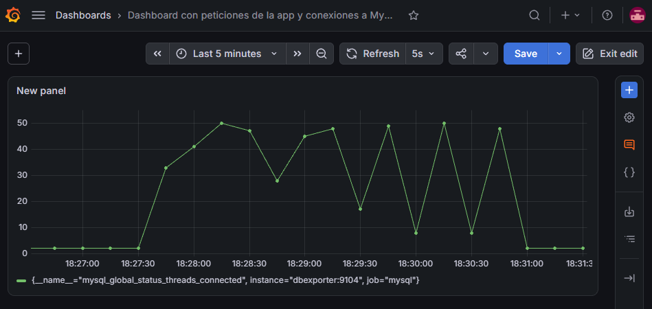
*Pico de conexiones a MySQL y posterior bajada.*

---

## Conclusión

Con el stack levantado se pudo ver, en vivo y en el mismo momento, lo que pasaba en cada capa: durante el stress test las conexiones a MySQL subieron de 2 a unas 50, las peticiones por segundo de la app aumentaron y la CPU del contenedor de MySQL pasó de cerca de 0,007 a más de 0,03. Cuando terminó la carga, los valores volvieron a bajar.

Cada parte del archivo cumple un papel: `mysql` y `dbexporter` ponen los datos y las métricas de la base, `cadvisor` y `prometheus` las recolectan, y `grafana` las muestra. Todo funciona porque están en la misma red, donde se encuentran por nombre, y porque `depends_on` ordena el arranque.

La diferencia con la práctica anterior es que los logs permiten investigar el detalle de lo que pasó después del incidente, mientras que las métricas permiten detectar el pico mientras ocurre. En un entorno real se usan las dos cosas.

Como mejoras, el archivo podría escribirse hoy sin `version:`, con versiones fijas en lugar de `latest`, la contraseña en un `.env` fuera de Git, un volumen con nombre para los datos de MySQL, y un `healthcheck` con `condition: service_healthy` para que `dbexporter` espere a que MySQL esté realmente listo.
